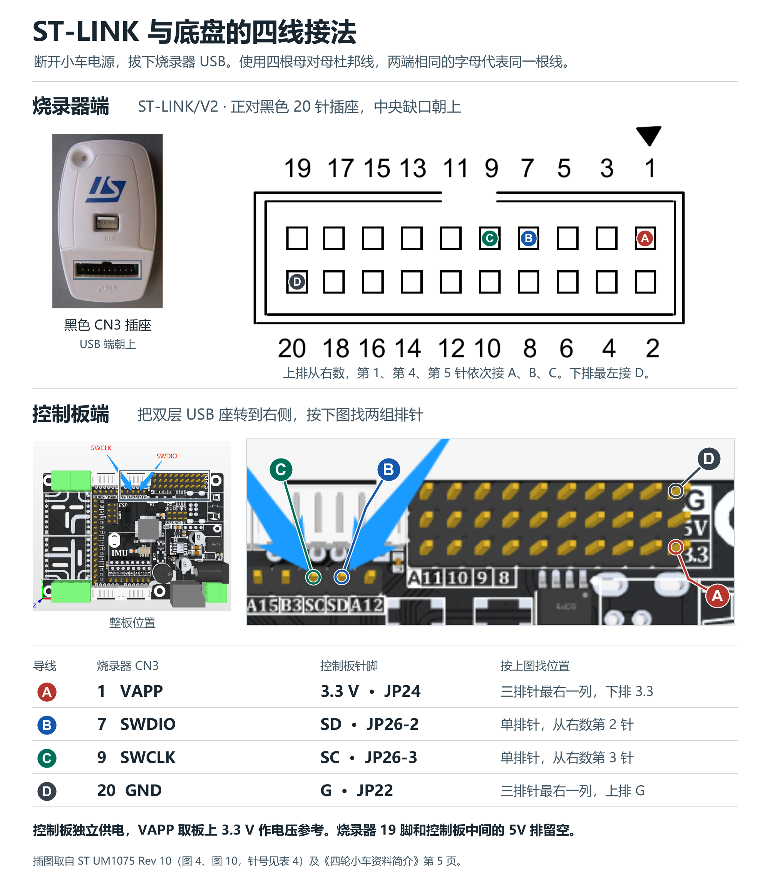

# 环境准备与实车验收

截至 2026-11-21，底盘已装好，四轮接线和 GY-521 有装车照片。现有探针外形与 ST-LINK/V2 标准双接口款一致。首次 SWD 读回和实车试验待执行。第一次验证用空载底盘，机械臂安装后再做带臂复测。[板级接线与资源](architecture.md) · [串口 v1 与收发样例](base-interface.md)

## Windows 开发环境

本机已验证 CubeCLI 0.10.4。项目锁定 GNU Tools for STM32 14.3.1+st.2、CMake 4.3.1+st.1 和 Ninja 1.13.2+st.1。新机器先安装 CubeCLI，在新终端从仓库根目录执行下列命令。普通构建直接使用仓库中的启动文件、链接脚本和驱动源码。[CubeCLI 安装](https://dev.st.com/stm32cube-docs/stm32cubecli/latest/en/docs/markup/STM32CubeCLI_Getting_Started/STM32CubeCLI_Installation.html) · [项目工具锁](../firmware/.settings/bundles-lock.store.json)

```powershell
cd firmware
cube bundle install --project
cube cmake --preset Debug
cube cmake --build --preset Debug
```

输出为 `firmware/build/Debug/baize_base.elf`。将两条构建命令的预设改为 `Release` 可生成优化版本。目标为 Cortex-M3 / Thumb-2，Flash 从 `0x08000000` 开始共 256 KiB，SRAM 从 `0x20000000` 开始共 48 KiB，初始栈顶为 `0x2000C000`。[链接脚本](../firmware/STM32F103xx_FLASH.ld)

修改外设时用经典 CubeMX 6.19.0 打开工程配置，使用 STM32CubeF1 1.8.7 重新生成。目前已配置 SWD、8 MHz 晶振倍频至 72 MHz、115200 的 USART2、四路编码器输入、PA4 电压采样和重映射的 I2C1。TIM8 与电机方向脚留待停机电平试验。首次上板在电机动力隔离条件下进行。[CubeMX 工程](../firmware/baize_base.ioc) · [STM32CubeF1 1.8.7](https://github.com/STMicroelectronics/STM32CubeF1/tree/v1.8.7)

本机已安装 STM32CubeProgrammer CLI 2.23.0。新机器可在仓库根目录执行 `cube bundle install programmer` 安装。仅将探针 USB 接到电脑，执行 `cube programmer -l st-link-only` 枚举探针。Windows 需要驱动时使用 STSW-LINK009。后续源码断点调试使用 ST-LINK GDB server 和 Arm GDB。底盘上层 USB 数据口另由 CH340 提供 COM 口。[STM32CubeProgrammer](https://www.st.com/en/development-tools/stm32cubeprog.html) · [ST-LINK Windows 驱动](https://www.st.com/en/development-tools/stsw-link009.html)

## 桌面验证

从仓库根目录执行以下命令。本机使用原生 GCC 12.1、CMake 和 Ninja，测试直接调用固件与主机共用的 C 编解码。三项 CTest 分别验证协议、板端驱动状态和上位机会话。

```powershell
cmake -S tests -B build/desktop -G Ninja -DCMAKE_C_COMPILER=gcc
cmake --build build/desktop
ctest --test-dir build/desktop --output-on-failure
```

五个文档样例逐字节比对，覆盖分段收帧、连续帧、超长帧和错误帧后的恢复。模拟时钟验证启停、整组目标越界、超时边界、毫秒回绕和故障恢复。主机每次打开串口时应先清空串口输入缓冲并重建会话，立即发停机，收到本次未使能状态后方可请求使能。新目标在收到已使能反馈后提交，每次提交最多发送一次。只收到 IMU 数据时，四轮状态仍可过期并触发停机。[协议样例](base-interface.md) · [桌面测试](../tests/)

测试数据中的速度上限和时限仅用于推进模拟时钟与检查边界。实车参数由台架标定确定，停机电平、机械停稳时间和距离分别实测。

## 首次 SWD 连接与上电

实物的黑色双排座对应 ST-LINK/V2 的 CN3（STM32 JTAG/SWD，2×10 针），金属小接口用于 STM8 SWIM。按实物的 1 脚标记、排线标记和手册图 10 核对方向。图 10 是从 PCB 上方看的视图，排线插头接触面与之镜像。[ST 用户手册 UM1075 Rev 10，图 4、表 4、图 10](https://www.st.com/resource/en/user_manual/dm00026748-st-link-v2-in-circuit-debugger-programmer-for-stm8-and-stm32-stmicroelectronics.pdf#page=8)



| ST-LINK/V2 CN3 | 小车控制板 | 用途 |
| --- | --- | --- |
| 1 · VAPP（2 脚同名） | JP24 的 3.3 V | 控制板独立供电，从板上取目标电压参考。 |
| 7 · SWDIO | JP26 第 2 脚 · PA13 / SWDIO | 双向数据。 |
| 9 · SWCLK | JP26 第 3 脚 · PA14 / SWCLK | 调试时钟。 |
| 20 · GND | JP22 的 GND | 两端共地。 |

CN3 第 19 脚为探针侧 VDD（3.3 V），本车接线将其留空。第 15 脚为 NRST，首次四线连接时留空。小车说明第 5 页有 SWCLK、SWDIO 在板上的箭头，3.3 V 和 GND 分别见原理图 JP24、JP22。[ST 针脚表，第 12 页](https://www.st.com/resource/en/user_manual/dm00026748-st-link-v2-in-circuit-debugger-programmer-for-stm8-and-stm32-stmicroelectronics.pdf#page=12) · [车板位置图，第 5 页](四轮灵风小车资料/四轮小车资料简介.pdf#page=5) · [运动控制板原理图](四轮灵风小车资料/原理图.pdf)

| 顺序 | 操作与通过条件 |
| --- | --- |
| 单独识别探针 | 小车断电，SWD 线留空，仅接探针 USB。枚举成功后记录探针型号和固件版本。 |
| 断电接线 | 拔下探针 USB，隔离电机动力，按上表接好 SWD 四线。对照原图核对电源极性、四个六针插座、GY-521 的 VCC/GND 和 U7 针序。接线核对后让控制板独立供电，再接探针 USB。 |
| 首次只读 | 用 `cube programmer -c port=SWD mode=HOTPLUG -ob displ` 查看器件 ID、Flash 容量和读保护状态。可读时按实际容量用 `-u` 导出从 `0x08000000` 开始的原 Flash，复核文件长度和 SHA-256。若读保护限制备份，记录限制并结束只读检查，解除保护可能擦除原内容。 |
| 下载与调试 | 进入固件阶段后写入可追溯的 ELF，读回校验通过。在电机动力隔离时验证源码断点命中和复位启动，退出调试后确认正常运行。记录固件版本和校验结果。 |

## 台架验收

四轮架空。在同一份记录中写入固件、工具和参数版本。调试器可观察编码器原始累计值，日常联调通过串口帧完成。涉及误差、偏置和抖动的项目先用标定数据定出该版本的容差，再用另一组数据验收。

| 检查项 | 做法与观测量 | 通过条件 |
| --- | --- | --- |
| 输出与停机 | 电机动力隔离时，测上电、复位、未使能和停机的 PWM/方向电平。确认后断电接回电机，架空复查。 | 记录四路停止输出的实际组合。未使能时四轮保持静止，运动中停机后进入该组合，记录制动或滑行表现。 |
| 轮序与每圈计数 | 未使能时，按轮胎标记将每个轮子沿使车辆前进的滚动方向手转整圈，再反转回起点。用 SWD 记录可跨定时器回绕的累计计数差，通过 `81` 读四轮转角。 | 每次仅对应轮有转角变化。确定原始符号及每输出轴一圈的计数，应用标定后正转一圈约 +2π rad，反转回到起始值，误差在对位与计数量化容差内。 |
| 电机方向与闭环 | 先以板级调试限幅逐轮短时点动，核对实际转向与该轮反馈。符号确定后，用 `03` 一次只给一轮低速，再试四轮正反转与零目标。 | 单轮正目标使该轮沿前进方向转动，实测角速度与转角增量均为正，其余轮保持静止。保存目标与实测曲线，跟踪误差和输出限幅满足该版标定。 |
| 电源电压 | 用万用表测控制板输入端，同时记录 `81` 的 mV 值，在不同实际电压下复测。 | 单位、变化方向正确，校准后的各点误差在已记录容差内。首个有效样本前主机识别 `0xFFFF` 为无读数。 |
| IMU 身份与静止 | 读实际 7 位地址和 WHO_AM_I，记录量程。架稳底盘，采一段 `82`，算三轴角速度均值、加速度模长和采样间隔。 | WHO_AM_I 为 `0x68`。静止角速度接近零，模长约 9.81 m/s²。在已知某传感器轴朝上时，该轴应读到约 +g。记录各轴偏置、波动与时间间隔。 |
| IMU 安装朝向 | 保持电机停机，将底盘绕已知车身轴做受控倾斜和正向转动。用重力响应核对倾斜，用陀螺主轴和符号核对旋转。 | 确定三个传感器轴与车身轴的对应和正负，将安装变换记在主机配置中。换算到车身后，从上方看逆时针左转时 z 角速度为正。 |
| IMU 缺失与恢复 | 模拟一次读取失败。另做一次断电取下模块的启动试验，再断电装回。观察 `81`、`82` 和轮速控制周期。 | 失败样本无 `82`，持续缺失时主机显示 IMU 不可用或过期，有新采样后恢复显示。四轮状态和闭环仍按各自周期运行。 |

## 通信与运动保护

令 `T_cmd` 为该版运动命令超时时限，`T_loop` 为板端轮速控制周期。用板端事件时间或输出引脚波形测驱动切换时间，另用轮速记录或实车录像测机械停稳。

| 试验 | 操作与通过条件 |
| --- | --- |
| 编解码与计数回绕 | 桌面端逐字节核对五种帧的测试向量，以及拆包、连包、超长、错长度和错 CRC 后紧随正确帧的恢复。用跨边界输入核对编码器计数及板端毫秒回绕。上板复核单位、轮序、IMU 轴序及端到端间隔。 |
| 停机与断流 | 架空低速时发停机，从有效命令接收到停止输出最多 `T_loop`。另试停止发目标、直接拔 USB 两种情况，从最后有效目标到停止输出最多 `T_cmd + T_loop`，驱动撤销使能。记录主动停机或超时原因。 |
| 非法数据与独立遥测 | 用坏 CRC、单轮越界的目标或重复使能替代正常续发，三者均应按原时限停机，越界目标整组丢弃。另在主机端只屏蔽 `81`，继续接收 `82`。状态过期后，主机应停止续发目标并在链路可用时发送停机。 |
| 重连、复位与恢复 | 保留一个旧的非零目标，分别重开串口、重启上位机工具和复位底盘。主机丢弃旧目标并执行停机握手，收到未使能反馈后，只有重新使能并给出新目标才恢复运动。重建累计角和采样时间基准。 |

两路遥测同时开启时，按方向记录实际串口占用、两类采样的平均及最大间隔，用于确定发布参数。

## 空载与带臂验收

1. **空载先测。** 在同一地面做已知距离的直行和已知角度的左右转向，用卷尺和地面角度标记取得独立参考。用部分行程标定有效滚动周长和有效轮距，用另外的行程核对里程计。记录低速跟踪误差、直行距离误差、转向误差、停机初速度和实际停稳距离。
2. **装臂后复测。** 记录机械臂及负载质量、固定姿态、地面、电池状态、速度上限。重做同组直行、转向、控速和停机试验，与空载记录逐项比较，再确定适用的速度上限与标定参数。
3. **按工况签收。** 每次保存参数与容差、实测值、原始日志和结论。空载通过后可交付空载结果，带臂验收保留待测直至实装验证。串口 v1 标记发布以真实固件与独立工具完成五类帧互通、停机和恢复试验为依据。
