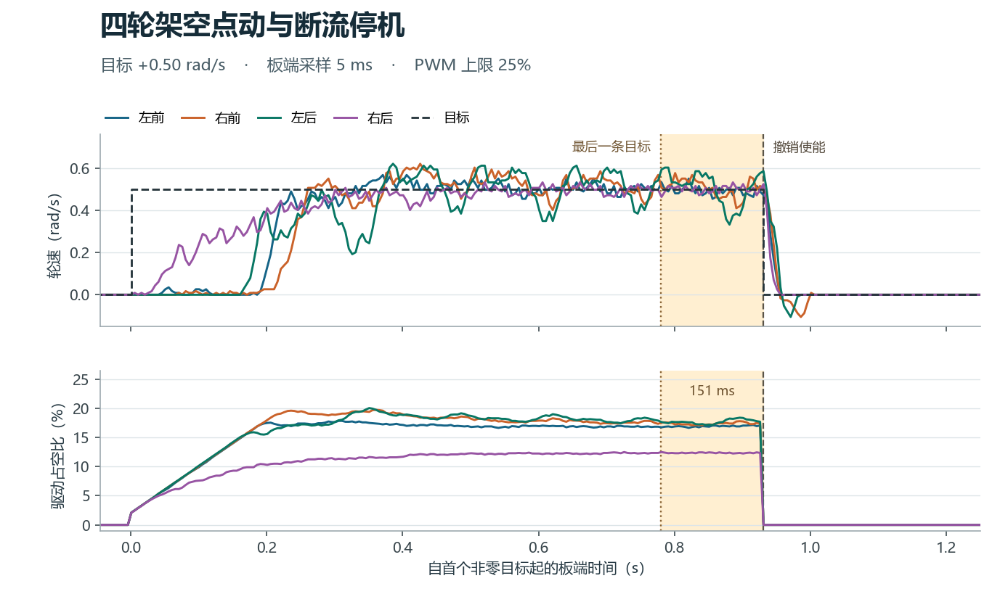
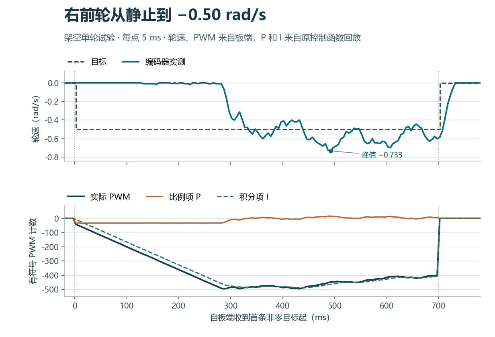
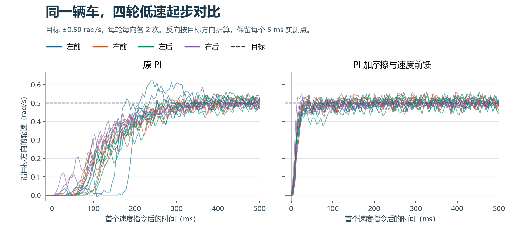
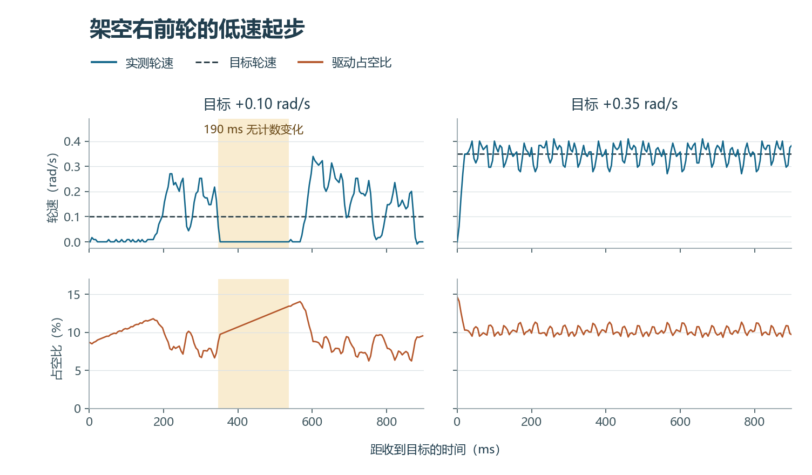
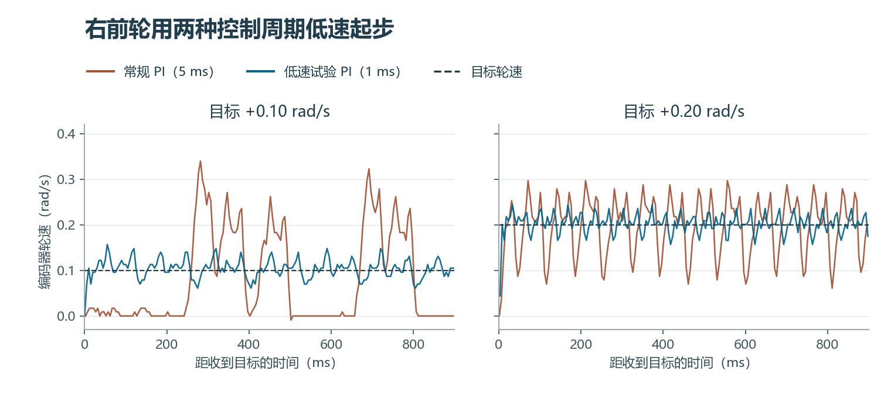

# 环境准备与实车验收

截至 2026-11-22，5 ms PI 加前馈的 Release 候选固件已在车上运行。架空时已测主动停机、断流、主循环卡住和 HardFault，完成镜像回退演练。Windows 和 Linux 仓库外程序已用 SWD 测试通道驱动实车。地面几何、停距、IMU 安装变换和真实 CH340 链路待实物验收。[候选版台架记录](#空载-v1-候选版的台架记录) · [板级接线与资源](architecture.md) · [串口 v1 与收发样例](base-interface.md)

## Windows 开发环境

本机已验证 CubeCLI 0.10.4。项目锁定 GNU Tools for STM32 14.3.1+st.2、CMake 4.3.1+st.1 和 Ninja 1.13.2+st.1。新机器先安装 CubeCLI，在新终端从仓库根目录执行下列命令。普通构建直接使用仓库中的启动文件、链接脚本和驱动源码。[CubeCLI 安装](https://dev.st.com/stm32cube-docs/stm32cubecli/latest/en/docs/markup/STM32CubeCLI_Getting_Started/STM32CubeCLI_Installation.html) · [项目工具锁](../firmware/.settings/bundles-lock.store.json)

```powershell
cd firmware
cube bundle install --project
cube cmake --preset Debug
cube cmake --build --preset Debug
```

输出为 `firmware/build/Debug/baize_base.elf`。将两条构建命令的预设改为 `Release` 可生成优化版本。目标为 Cortex-M3 / Thumb-2。工程按图纸标注的 RCT6 链接，Flash 从 `0x08000000` 开始分配 256 KiB，SRAM 从 `0x20000000` 开始分配 48 KiB，初始栈顶为 `0x2000C000`。[链接脚本](../firmware/STM32F103xx_FLASH.ld)

修改外设时用经典 CubeMX 6.19.0 打开工程配置，使用 STM32CubeF1 1.8.7 重新生成。目前已配置 SWD、8 MHz 晶振倍频至 72 MHz、115200 的 USART2、四路编码器和 TIM8 输出、方向 GPIO、PA4 电压采样、重映射的 I2C1 和 PA5 数据就绪中断。[CubeMX 工程](../firmware/baize_base.ioc) · [STM32CubeF1 1.8.7](https://github.com/STMicroelectronics/STM32CubeF1/tree/v1.8.7)

本机烧录使用 STM32CubeProgrammer CLI 2.23.0，源码断点使用 ST-LINK GDB server 7.14.0 和 Arm GDB。新机器可执行 `cube bundle install programmer stlink-gdbserver` 安装。仅将探针 USB 接到电脑，执行 `cube programmer -l st-link-only` 枚举探针。若 Windows 已出现“STM32 STLink”并报代码 28，安装 ST 官方调试驱动 `stlink_dbg_winusb.inf` 后重试。本机验证的驱动版本为 2.2.0.0。底盘上层 USB 数据口另由 CH340 提供 COM 口。[STM32CubeProgrammer](https://www.st.com/en/development-tools/stm32cubeprog.html) · [ST-LINK Windows 驱动](https://www.st.com/en/development-tools/stsw-link009.html)

## 桌面验证

从仓库根目录执行以下命令。本机使用原生 GCC 12.1、CMake 和 Ninja。四项 C 测试分别验证协议、板端驱动状态、编码器计数和上位机会话。安装 Python 3 后还会运行地面几何复算测试。编码器测试覆盖正反向跨零、静止、反转回到起点和超出有符号 32 位范围的累计值，并检查四路按厂商符号正反转一整圈时分别得到 +6283 和 −6283 mrad。

```powershell
cmake -S tests -B build/desktop -G Ninja -DCMAKE_C_COMPILER=gcc
cmake --build build/desktop
ctest --test-dir build/desktop --output-on-failure
```

五个文档样例逐字节比对，覆盖分段收帧、连续帧、超长帧和错误帧后的恢复。模拟时钟验证启停、整组目标越界、超时边界、毫秒回绕和故障恢复。主机每次打开串口时应先清空串口输入缓冲并重建会话，立即发停机，收到未使能且原因为主动停机的新状态后方可请求使能。新目标在收到已使能反馈后提交，每次提交最多发送一次。只收到 IMU 数据时，四轮状态仍可过期并触发停机。[协议样例](base-interface.md) · [桌面测试](../tests/)

Linux 安装 Python 3 后，可用下面的命令复测全部七项。其中两项通过伪终端运行同一个主机可执行文件，分别检查双路采集和限时点动。

```sh
cmake -S tests -B build/linux-tests
cmake --build build/linux-tests
ctest --test-dir build/linux-tests --output-on-failure
```

桌面状态机边界样例使用各自的速度上限和模拟时钟。实车编码器采用厂商默认配置，台架控制限幅和指令时限随对应固件记录。

### 2026-11-22 上位机会话与实车数据回放

- Windows 和 Linux 均从独立的 C++ 工程链接并运行 `baize_host`。桌面用例覆盖了初始停机回执丢失、待发目标遇到板端时钟倒退、已发使能后板端复位，以及 32 位板端时间自然回绕。Windows 四项、Linux 六项 CTest 通过。[主机接入](base-interface.md#上位机-c-库) · [会话测试](../tests/test_session.c)
- Linux 伪终端用 `baize-monitor` 实际运行限时点动。模拟持续重发同一个已使能轮样本、同时正常更新 IMU 时，修正前到约 1.82 s 点动结束才发停机。修正后，本次从首条轮速目标到主机发出停机为 270 ms。该工具的轮反馈过期阈值为 250 ms，约每 20 ms 检查一次。监视模式另外验证了重复 IMU 样本仅记录一次，过期后仍记录车轮，新六轴样本到达时恢复。[点动回归](../tests/test_jog.py) · [监视回归](../tests/test_monitor.py)
- 将上一日通过 SWD 保存的板端原始帧经 Linux 伪终端回放给联调工具和 C++ 应用。两者各读到 150 帧轮状态、150 帧 IMU。工具 CSV 的板端时间、状态、停机原因、电压、轮角、轮速及六轴值均与独立解码逐项一致。录制时的停机原因为上电，C++ 应用在整段回放中保持未使能。实物 USB 试验到线后单独记录。

## USB 状态监视工具

将本板用的 USB-A 公对公数据线接在**电脑矩形 USB-A 口与控制板双层 USB 座上层**之间，控制板用小车原电源供电。Windows 设备管理器枚举出 CH340 后记下它的 COM 号。如果看到沁恒的设备标识 `VID_1A86` 且报代码 28，再安装 CH341SER 串口驱动。若插线前后连 USB 设备列表都没有变化，先检查线型与板端插口。[随车说明第 2 页](四轮灵风小车资料/四轮小车资料简介.pdf#page=2) · [Microsoft USB 枚举故障说明](https://learn.microsoft.com/zh-cn/windows-hardware/drivers/usbcon/case-study--troubleshooting-an-unknown-usb-device-by-using-etw-and-netmon) · [沁恒官方驱动](https://www.wch.cn/downloads/CH341SER_EXE.html)

从仓库根目录构建。以下命令采集 250 帧并保存 CSV，将示例端口换成实际设备名。省略帧数可持续监视，去掉重定向可直接看终端输出。

**Windows（PowerShell）**

```powershell
cmake -S host -B build/host -G Ninja -DCMAKE_C_COMPILER=gcc
cmake --build build/host
.\build\host\baize-monitor.exe COM7 250 > build/host/status.csv
```

**Linux**

```sh
cmake -S host -B build/linux-host
cmake --build build/linux-host
./build/linux-host/baize-monitor /dev/ttyUSB0 250 > build/linux-host/status.csv
```

工具以 115200、8N1 打开串口并发送停机。实物验收时，复位后打开端口，应收到驱动未使能（`drive_state=0`）且停机原因为主动停机（`stop_reason=2`）的状态。CSV 前两列分别是从本次打开起的主机接收时间和板端采样时间，单位均为 ms。四轮顺序为左前、右前、左后、右后，转角为 rad，角速度为 rad/s，电压为 V，无有效电压时留空。连续 1 秒没有有效底盘状态，工具报错退出。[监视工具源码](../host/monitor.c)

同时采集六轴时，在帧数后加 `--imu-csv build/imu.csv`。两个文件分别保存各自的采样时间，帧数仍按轮状态计算。IMU 文件三轴加速度为 m/s²，三轴角速度为 rad/s。连续 1 秒没有六轴新样本时，工具在标准错误报告一次，轮状态继续记录。六轴恢复时报告恢复并续写原文件。

**架空点动。** 四轮悬空后，下面的例子只给左前轮下发 +0.5 rad/s，持续 300 ms。依次替换四个轮速中的非零项即可核对轮序与方向。工具先确认主动停机，再使能，收到已使能反馈后按约 20 ms 间隔发送目标。到时或按 Ctrl+C 发停机，等待未使能和主动停机原因。反馈失联中止本次点动。工具接受 1～2000 ms 和每轮 ±2 rad/s，轮状态可直接重定向保存。

```powershell
.\build\host\baize-monitor.exe COM7 --jog 300 0.5 0 0 0 --imu-csv build/host/jog-imu.csv > build/host/jog-wheels.csv
```

## 首次 SWD 连接与上电

实物的黑色双排座对应 ST-LINK/V2 的 CN3（STM32 JTAG/SWD，2×10 针），金属小接口用于 STM8 SWIM。按实物的 1 脚标记、排线标记和手册图 10 核对方向。图 10 是从 PCB 上方看的视图，排线插头接触面与之镜像。[ST 用户手册 UM1075 Rev 10，图 4、表 4、图 10](https://www.st.com/resource/en/user_manual/dm00026748-st-link-v2-in-circuit-debugger-programmer-for-stm8-and-stm32-stmicroelectronics.pdf#page=8)


| ST-LINK/V2 CN3 | 小车控制板 | 用途 |
| --- | --- | --- |
| 1 · VAPP（2 脚同名） | JP24 的 3.3 V | 控制板独立供电，从板上取目标电压参考。 |
| 7 · SWDIO | JP26 第 2 脚 · PA13 / SWDIO | 双向数据。 |
| 9 · SWCLK | JP26 第 3 脚 · PA14 / SWCLK | 调试时钟。 |
| 20 · GND | JP22 的 GND | 两端共地。 |

CN3 第 19 脚为探针侧 VDD（3.3 V），本车接线将其留空。第 15 脚为 NRST，首次四线连接时留空。小车说明第 5 页有 SWCLK、SWDIO 在板上的箭头，3.3 V 和 GND 分别见原理图 JP24、JP22。[ST 针脚表，第 12 页](https://www.st.com/resource/en/user_manual/dm00026748-st-link-v2-in-circuit-debugger-programmer-for-stm8-and-stm32-stmicroelectronics.pdf#page=12) · [车板位置图，第 5 页](四轮灵风小车资料/四轮小车资料简介.pdf#page=5) · [运动控制板原理图](四轮灵风小车资料/原理图.pdf)

| 顺序 | 操作与通过条件 |
| --- | --- |
| 单独识别探针 | 小车断电，SWD 线留空，仅接探针 USB。枚举成功后记录探针型号和固件版本。 |
| 断电接线 | 拔下探针 USB，按上表接好 SWD 四线。对照原图核对电源极性、四个六针插座及 GY-521 在 U7 的 VCC/GND。保留电机插头，稳固架起车架，四轮悬空、线缆远离轮胎。接线核对后让控制板独立供电，再接探针 USB。 |
| 首次只读 | 用 `cube programmer -c port=SWD mode=HOTPLUG -ob displ` 查看器件 ID、Flash 容量和读保护状态。可读时按实际容量用 `-u` 导出从 `0x08000000` 开始的原 Flash，复核文件长度和 SHA-256。若读保护限制备份，记录限制并结束只读检查，解除保护可能擦除原内容。 |
| 下载与调试 | 台架保持上述接线。从仓库根目录执行 `cube programmer -c port=SWD freq=480 reset=SWrst -d firmware/build/Debug/baize_base.elf -v -rst`，写入该版固件、校验并软件复位。在驱动未使能时检查源码断点，退出调试后确认采样时间继续推进，记录固件版本。 |

### 2026-11-21 首次只读结果

- 控制板断电时，Windows 通过 USB 识别到 ST-LINK/V2（`0483:3748`），探针固件为 `V2J45S7`。随后保留四个电机插头，用户确认车架稳固、四轮悬空，上电后四轮静止。
- 以 480 kHz 热连接，目标电压读数为 3.22 V。CubeProgrammer 识别为 STM32F101/F103 高密度系列，设备 ID 为 `0x414`，修订版显示 Rev X，读保护关闭。容量寄存器 `0x1FFFF7E0` 读得 `0x0200`，与工具报告的 512 KiB 一致。图纸标注 STM32F103RCT6，实物完整料号待核对芯片丝印。
- 从 `0x08000000` 独立读回两次，每份 524,288 字节，逐字节相同且全为 `0xFF`。主 Flash 呈擦除态。快照 `original-flash.bin`、第二份读回及校验清单位于本机 `%LOCALAPPDATA%\Baize\Backups\20261121-145708-95c910b1\`。两份 SHA-256 均为 `043e238a765f7cfbc62596a50e53c8ffb6b188a99357b0ebede251725d67589f`。

### 2026-11-21 首次烧录与编码器验证

- 保留四个电机插头，用 480 kHz SWD 烧录提交 `50d6326` 的 Debug 固件。CubeProgrammer 校验成功。从 `0x08000000` 独立读回的 13,072 字节与构建镜像逐字节相同，SHA-256 为 `6aa10ccf399cecfa592785fe934320481d54813d936368a33ee45fe103fd556c`。
- 四个编码器定时器均已启动，双路编码器模式和两路输入滤波值 15 均从寄存器读回。Arm GDB 在 `baize_encoders_sample` 命中硬件断点。通过 SWD 给左前、右前、左后、右后对应的计数器注入位移 `[-12000, 24000, -6000, -18000]`，板上得到轮角 `[524, -1047, 262, -785]` mrad。恢复计数器后，四路累计计数和轮角均回到零。该试验覆盖定时器寄存器到轮角的软件路径。
- 退出调试并再次软件复位后，两次热连接读到的采样时间分别为 437 ms 和 872 ms，内核处于运行态，TIM8 的 PWM 时钟关闭。实物轮序和机械转向待首次点动核对。ELF、独立读回和日志保存在本机 `%LOCALAPPDATA%\Baize\Validation\20261121-153505-50d6326\`。

### 2026-11-21 轮速、电压与状态帧验证

- 固件提交 `2a7c3db` 的 Debug 镜像经 SWD 独立读回，22,072 字节与构建结果逐字节一致。SHA-256 为 `d9ed986cb6e23842d8dc6bcfe7b2f479c07d9dda4875db3196d5b66548a33005`。Debug、Release、Windows 与 Linux 监视工具均已构建，四项桌面测试通过。
- 在实车 USART2 发送完成中断处通过 SWD 连续取出 50 个 62 字节状态帧。经 Linux 伪终端回放给监视工具，50 帧均通过协议校验。板端时间从 108580 到 109560 ms，49 个间隔均为 20 ms。驱动一直未使能，四轮累计转角和轮速均为零。板载 ADC 估算输入电压为 12.422～12.442 V，绝对精度待万用表比对。回放 CSV 的主机时间只反映回放时刻。
- 通过 SWD 向四个定时器注入 `[-115, +230, -345, -460]` 个计数，5 ms 测速窗口对应的帧解码为 `[+1.004, −2.007, +3.011, −4.014]` rad/s，累计转角为 `[+0.005, −0.010, +0.015, −0.020]` rad。恢复计数后读数归零。向板端串口接收回调逐字节注入错误 CRC 的停机帧后，停机原因仍为 1，注入有效停机帧后，下一帧读到未使能、停机原因 2。调试结束后复位，采样时间继续推进，停机原因恢复为 1，TIM8 时钟关闭。
- Linux 伪终端另行验证了开口停机、拆包与连包、错帧恢复、缺失电压和无数据超时。实车使用 A–C 线分别接电脑前置 Type-C 与后置雷电口时，Windows 未枚举到 CH340 或未知 USB 设备。**真实 USB 收发和停机往返待 A–A 数据线到位后验证。** 本机原始帧、回放 CSV、镜像和调试日志位于 `%LOCALAPPDATA%\Baize\Validation\20261121-161544-2a7c3db\`。

### 2026-11-21 MPU6050 实车采集与恢复

- 固件 `e82026f` 的 Debug 镜像读回 31,748 字节，SHA-256 为 `dd4faf98d4a41234d1b2839726a3cbe88980d137807e81e30f3543ecc37114f3`。经 SWD 在 MCU 连续运行时观察采样，300 个连续样本有 289 个 20 ms 间隔、10 个 21 ms 间隔，平均 49.92 Hz。独立核对 22 组 I²C 原始字节与固件换算，六轴均一致。
- 另取 6 秒静止数据，经 SWD 读到 USART2 发送缓冲里的 301 个轮状态帧和 298 个 IMU 帧，逐帧校验 CRC。IMU 样本的加速度模长均值为 9.218 m/s²，范围 9.176～9.273 m/s²。陀螺三轴均值为 `[−0.0905, +0.0211, +0.0365]` rad/s。以上为当前摆放下的原始反馈，传感器零偏、加速度比例和装车朝向待标定。
- 经 SWD 临时将 I²C 目的地址改为空地址，再单独屏蔽 PA5 就绪中断。两次故障期间分别采到 85、78 个轮状态帧，各自的板端间隔均为 20 ms。恢复地址和中断后，分别在 144 ms、407 ms 观测到首个新 IMU 样本。故障试验中电机未使能。实际拔下模块的冷启动与 USB 电缆端到端试验另行验收。
- 将整段板端数据按采样时间经 Linux 伪终端回放，主机工具记录 689 行轮反馈、495 行六轴数据，并分别报告两次 IMU 过期与恢复。Windows 四项、Linux 五项 CTest 通过。镜像、原始帧、双路 CSV 与故障标记存于 `%LOCALAPPDATA%\Baize\Validation\20261121-163826-imu\`。

### 2026-11-21 四轮调速与停机保护

- 固件 `0f3fe85` 的 Debug 镜像、独立 Flash 读回及最终重新构建的二进制逐字节相同，36,624 字节，SHA-256 为 `3539393faed55cff44664df39cca5772531c9e0edd4f66769a0b73c9795ad7b0`。上电未使能，TIM8 四路 CCR 均为 2000，PC6～PC9 实际输入电平均为高，四路编码器计数为零。
- 为在轮胎静止时核对控制链路，通过调试器临时将四个 PWM 引脚固定为同一停机高电平，保留电机接线和运行中的 TIM8。通过串口接收回调逐字节送入指令。未使能目标、错 CRC 和单轮超限目标均被丢弃。使能后给定 `[1.0, −0.7, −0.5, 0.4]` rad/s，首个调节周期的有符号 PWM 计数为 `[83, −58, −42, 33]`，对应的 CCR 和 DIR 映射正确。
- 向编码器计数器注入位移，产生 `[1.004, −0.698, −0.497, 0.401]` rad/s 的反馈，四路输出由 `[100, −70, −50, 40]` 降到 `[32, −23, −16, 13]`。反向目标先经过一个中性周期再切换方向。主动停机清零输出。满台架目标下各轮限幅在 ±300，最后一条有效目标后 150 ms 撤销使能，停机原因 3，四路 CCR 恢复 2000 且积分清零。该试验验证板端反馈和寄存器路径，机械停稳时间及跟踪曲线待实车运动测量。
- 恢复引脚复用并软件复位后，连续运行时通过 SWD 读到 150 帧轮状态和 150 帧 IMU，轮状态间隔全部为 20 ms，四轮计数仍为零。Windows 四项、Linux 六项 CTest 通过，Linux 伪终端覆盖了正常点动结束、轮反馈中断和 Ctrl+C 后的停机应答。构建、读回、注入脚本及复位后记录位于 `%LOCALAPPDATA%\Baize\Validation\20261121-165755-motion\`。

### 架空四轮实测

2026-11-21，车架架稳、四轮离地、机械臂未安装，保留电机接线。通过 ST-LINK 向临时台架固件提交停机、使能和限时轮速目标，由原有 `base_motion_command`、PI 和超时逻辑驱动实际 TIM8 引脚。MCU 在运动期间连续运行，每 5 ms 同步记录目标、四路真实编码器计数和速度、有符号 PWM、CCR、驱动状态及最新电压。全程 26 组点动，共 7655 个控制周期样本，分组内间隔均为 5 ms。速度按厂商每圈 144000 计数换算。

**起转与配对。** 每次从静止单独给一路 ±0.50 rad/s。在 15% 上限、450 ms 内，仅右后通道双向持续跟转。其余三路正向各走 1 个原始计数，反向分别走 19、16、90 个。20% 下单独复测左前，两个方向到末段依然停滞。25% 下单轮给定 700 ms，八次都在指定通道测到持续转动，反馈方向与目标一致，其余三路在整段记录中计数变化均为零。下表为撤去目标前 100 ms 的 **平均编码器轮速**。车轮名称沿用接线图，实际车身角位与朝车头的滚动方向待目视核对。

| 单轮点动，25% 上限 | 目标 +0.50 时实测（rad/s） | 目标 −0.50 时实测（rad/s） |
| --- | ---: | ---: |
| 左前 | +0.553 | −0.515 |
| 右前 | +0.560 | −0.566 |
| 左后 | +0.568 | −0.558 |
| 右后 | +0.504 | −0.497 |

**四轮联动。** 同时给四轮同一目标 850 ms，按相同的末 100 ms 窗口取平均，单位均为 rad/s。单轮与联动的起转过程存在速度波动，八次 ±0.50 单轮试验中最大瞬时反馈绝对值为 0.733 rad/s。给 ±2.00 时四个调速器均达到 25% 输出上限。

| 每轮目标 | 左前 | 右前 | 左后 | 右后 |
| ---: | ---: | ---: | ---: | ---: |
| +0.50 | +0.508 | +0.521 | +0.504 | +0.499 |
| −0.50 | −0.501 | −0.502 | −0.531 | −0.504 |
| +1.00 | +1.006 | +1.013 | +1.011 | +1.005 |
| −1.00 | −1.008 | −1.006 | −1.001 | −1.000 |
| +2.00 | +1.207 | +1.207 | +1.251 | +1.440 |
| −2.00 | −1.107 | −1.251 | −1.183 | −1.454 |

**停机。** 时间以板端收令和控制周期记录为准。输出归中指四路 CCR 全部回到 2000。余动时间从归中算到最后一次检测到编码器计数变化的采样，分辨率为 5 ms。

| 操作 | 驱动状态及轮端反馈 |
| --- | --- |
| 主动停机 | 所有主动停机点动均在收令后 0～4 ms 撤销使能并归中，原因码为 2。同时给 ±0.50 的两组试验中，最后变化的一路分别在归中后 50、55 ms 稳定。 |
| 四轮目标归零 | 先给左侧 +0.65、右侧 −0.65，再连续给四轮零目标。首个零目标后 1 ms 四路归中，期间维持已使能，最后变化的一路在归中后 145 ms 稳定。随后主动停机成功。 |
| 停止续发 | 四轮以 +0.50 运转，最后一条目标后 151 ms 撤销使能并归中，原因码为 3。四路分别在归中后 25、70、50、20 ms 出现最后一次计数变化，随后全部保持静止。 |



压缩包中 `samples.csv` 按试验名分组，`ms` 为板端毫秒，`raw_*` 为带原始方向的累计计数，`speed_mrad_s_*` 为已按前进方向换算的速度，`pwm_*` 为有符号的驱动计数，满量程 2000。`commands.csv` 的 `ms` 为运动指令的板端接收时刻，`op` 取 1（停机）、2（使能）或 3（四轮目标）。[下载实测数据](measurements/2026-11-21-wheel-bench.zip)

**板上最终状态。** 已将架空台架的 PWM 限幅由 300 调至 500 计数，并烧回常规固件。36,624 字节 Debug 镜像与此前版本仅有一个字节不同，SHA-256 为 `4a5a1a5d014219b650088d69d0e0607358ca26a3893c64f87ff053ad8aaa482f`。独立读回了台架固件涉及的全部 38,912 字节，核对了新镜像与原先保存的页尾。复位后连续读到 150 帧轮状态和 150 帧 IMU。驱动未使能，四路编码器静止，四路 CCR 均为 2000，轮状态间隔均为 20 ms。Windows 四项、Linux 六项桌面测试通过。测试固件、调试脚本、烧录日志及独立读回位于本机 `%LOCALAPPDATA%\Baize\Validation\20261121-171602-wheels\`。

### 轮速 PI 阶跃响应

2026-11-22 离线复核了上一节 26 组架空记录。用相邻原始编码器计数差重新换算轮速，将记录的目标、轮速、周期和各组限幅输入固件的 C 函数，再按板端换向规则核对 PWM。7655 个周期共 30620 个单轮输出与记录一致，其中 7564 个单轮更新带有非零目标。[轮速计算](../firmware/control/baize_encoders.c) · [PI 实现](../firmware/control/baize_drive.c) · [原始记录](measurements/2026-11-21-wheel-bench.zip)

下表取 25% 限幅、单轮从静止给 ±0.50 rad/s 的八次点动。每格按正向 / 反向排列。以首条非零目标的板端收令时刻为零点，`t10`、`t90` 分别取沿目标方向连续三个 5 ms 样本达到目标幅值 10%、90% 时的首个样本。峰值超调按整个给定期间计算，末段占空比取撤去目标前 100 ms 的输出绝对值平均。

| 轮通道 | t10（ms） | t90（ms） | 峰值超调（%） | 末段占空比（%） |
| --- | ---: | ---: | ---: | ---: |
| 左前 | 290 / 219 | 350 / 309 | 34.4 / 18.6 | 20.2 / 20.1 |
| 右前 | 267 / 287 | 452 / 327 | 30.8 / 46.6 | 21.7 / 20.6 |
| 左后 | 285 / 346 | 350 / 426 | 36.2 / 44.8 | 22.9 / 22.9 |
| 右后 | 99 / 28 | 299 / 323 | 8.2 / 6.4 | 12.9 / 12.8 |

右前反向的一次阶跃展示了两个控制项的作用。首个控制周期反馈为零，P 为 −33.6、I 为 −8.1，实际输出 −42 个 PWM 计数。到 492 ms 时实测轮速为 −0.733 rad/s，已经越过 −0.50 的目标。此时 P 转为 +15.7，抵消了一部分仍为 −463.3 的积分，输出为 −448 个计数。图中轮速及总输出取自板端，P 和 I 由控制函数和记录的反馈重建。



原版四轮同时给 ±1.00 rad/s 时，各轮末 100 ms 的平均绝对误差范围为 0.00785～0.02725 rad/s。给 ±2.00 rad/s 时四路在整个末 100 ms 均贴住 25% 限幅，持续给定期间均未达到目标的 90%。上述单轮每向各一条曲线，作为首次架空基线。

从仓库根目录运行下列命令，可按每个有目标的轮通道复算指标。脚本使用 Python 标准库，输出 CSV，未达到的阈值留空。

```sh
python docs/measurements/wheel_response.py docs/measurements/2026-11-21-wheel-bench.zip
```

### 四轮架空调参复验

2026-11-22，四轮架空、机械臂未安装。ST-LINK 在 MCU 连续运行时向临时固件提交限时指令，板端每 5 ms 记录编码器、有符号 PWM、CCR 和驱动状态。原始记录共 267 组、79,862 个控制周期，板载电压读数为 12.201～12.470 V。用相邻原始计数独立换算轮速，按各组参数回放常规固件的 C 控制函数，319,448 个单轮 PWM 和对应 CCR 与实测逐项相符。[实测数据包](measurements/2026-11-22-wheel-tune.zip)

先只调 PI 增益，±0.50 rad/s 的峰值超调降到 13.4% 以内，达到目标 90% 的中位时间延长到 410 ms。加入较大的前馈后，中位时间缩到 17 ms，峰值超调又达到 37.8%。最终采用较小的摩擦及速度前馈，四轮共用 PI 增益。输出上限单独从 25% 分级实测至 35%。四轮同给 ±2 rad/s 时，30% 上限下末 100 ms 八个轮向全部饱和，35% 时均可跟踪。[算法与参数](architecture.md#标定与验收依据)

**单轮对照。** 新旧参数交替运行，每轮每向各从静止给 ±0.50 rad/s 两次，每次约 800 ms，每版合计 16 次。两版使用相同的 700 计数上限，实测输出分别最高 311、365 计数，所有非目标通道的 PWM 和计数增量均为零。复验门槛取每次 t90 ≤120 ms、峰值超调 ≤20%、末 100 ms 平均轮速与目标相差 ≤0.025 rad/s。最终参数 16 次全部达到。

| 单轮 ±0.50 rad/s | 原 PI | 本次固件 |
| --- | ---: | ---: |
| 达到目标 10% 的时间，中位数 | 77 ms | 6 ms |
| 达到目标 90% 的时间，中位数（最短～最长） | 256.5 ms（170～344） | 27 ms（15～101） |
| 峰值超调，中位数 / 最差一次 | 10.0% / 24.0% | 10.0% / 11.8% |
| 整段平均绝对误差，各次中位数 | 0.1060 rad/s | 0.0291 rad/s |
| 末 100 ms 平均绝对误差，各次中位数 | 0.0190 rad/s | 0.0186 rad/s |



**四轮联动。** 固定最终参数，另给正向、反向各 900 ms。下表取四轮两个方向共八个结果。均值用来衡量持续跟踪，峰值用全部 5 ms 样本计算。

| 目标幅值（rad/s） | 末 100 ms 平均轮速幅值范围（rad/s） | 最差峰值超调 |
| ---: | ---: | ---: |
| 0.10 | 0.010～0.199 | 240.0% |
| 0.25 | 0.234～0.254 | 46.8% |
| 0.35 | 0.345～0.360 | 24.6% |
| 0.50 | 0.495～0.503 | 11.8% |
| 1.00 | 0.992～1.004 | 3.8% |
| 2.00 | 1.993～2.008 | 2.1% |

±0.10 rad/s 未通过平滑爬行复核。正向给定期间，右前通道有连续 170 ms 的原始计数没有变化。±0.25 rad/s 的末段均值接近目标，瞬时速度仍有波动。落地后的最小平滑轮速需结合载荷和地面复测。

**独立目标与停机。** 四轮分别给 `[+0.45, −0.85, +1.20, −1.55]` rad/s，末 100 ms 平均反馈为 `[+0.454, −0.847, +1.202, −1.545]` rad/s。给四路相反目标时，反馈为 `[−0.447, +0.852, −1.192, +1.550]` rad/s。另一组在运动中直接将四路目标反号，四路均先经过中性输出再反向跟踪。主动停机在 0～4 ms 内撤销使能，四轮零目标在 3 ms 后归中且保持使能。停止续发后 151 ms 撤销使能并归中，原因码为 3。随后左前、右前、左后、右后最后一次编码器计数变化分别出现在 25、35、45、30 ms。

**复算与回退。** 数据包内 `configs.csv` 和 `trials.csv` 给出逐组参数、试验名和样本数。`ref700-accept-*`、`tuned-accept-*` 对应上表两版单轮对照，`acceptance-*` 为独立复验。运行下列命令可复算全部恒定目标的指标，`sequences/` 保留换向和零目标的完整时序。两条探索记录分别出现过归中后和非目标通道的单个编码器计数变化，对应 PWM 均为零，原记录及备注保存在数据包内。

```sh
python docs/measurements/wheel_response.py docs/measurements/2026-11-22-wheel-tune.zip
```

常规 Debug 镜像为 36,760 字节，SHA-256 为 `b55ae4c3af40586d80cc91c014a5c7a7e11cbae72c17d370c7ff2ff84e48ebc7`。已烧回常规固件，从 Flash 独立读回 49,152 字节，核对了镜像和台架试验前保存的页尾。复位后读回四轮增益及零积分，驱动未使能，四路 CCR 均为 2000，编码器静止。另从板端样本时间测得轮状态 50.00 Hz、IMU 49.92 Hz。Debug、Release 构建和 Windows 四项、Linux 六项桌面测试通过。本机镜像、读回和调试记录位于 `%LOCALAPPDATA%\Baize\Validation\20261122-031413-tune\`。前一版常规固件保存在同级的 `20261121-171602-wheels\` 目录。

### 架空低速下限与微分对照

2026-11-22，四轮架空、未装机械臂，以 `988dd02` 的 PI 和前馈参数为基准。通过 ST-LINK 在 MCU 连续运行时测试 224 组，其中 188 组使用当前 PI，36 组加入测速微分。共记录 65,918 个 5 ms 控制周期，板载电压读数为 12.330～12.463 V，全程保留板端 150 ms 超时。四轮同时给同方向目标，每档维持约 900 ms。分别从静止起步、从同向 0.50 rad/s 降速，并在不同车轮起始角度重复起步。降速前用末 100 ms 的反馈确认四轮已在转动。[原始计数、PWM、命令与参数](measurements/2026-11-22-wheel-floor.zip)

本轮采用以下架空判据。它们分别回答能否起动、能否连续跟踪，以及低速波动是否足够小。

| 判据 | 测量方法 |
| --- | --- |
| 从静止起动 | 连续三个同向样本达到目标幅值的 50%，且首个样本距收令不超过 250 ms。 |
| 连续跟踪 | 取末 600 ms，沿目标方向没有计数进展的连续时间小于 30 ms，任一滑动 100 ms 窗口的平均速度误差不超过目标幅值的 20%。 |
| 平滑跟踪 | 满足连续跟踪，且末 600 ms 逐点绝对速度误差的第 95 百分位不超过目标幅值的 25%。 |

**架空持续平稳轮速的建议下限为 0.35 rad/s。** 在测过的档位中，0.15 rad/s 是所有静止起步都成功的最低档，0.25 rad/s 是所有轮次都能连续跟踪的最低档。0.325 和 0.350 rad/s 各有 104/104 个轮次通过平滑判据，两档最差轮次的第 95 百分位误差分别为目标的 24.9% 和 22.6%。选择 0.35 rad/s（约 3.3 转/分）给 25% 的判据留出余量。该值供规划架空持续转动使用，空载落地与装臂后的下限分别实测。[上位机如何使用该值](base-interface.md#启停与异常行为)

下表合并全部 PI 组，含微分对照中的 PI 基线。每轮在一次给定中计一个轮次，分数为通过数/实测数。起动列仅含静止起步，连续、平滑两列还包含从转动中降速的轮次。

| 目标幅值（rad/s） | 从静止起动 | 连续跟踪 | 平滑跟踪 |
| ---: | ---: | ---: | ---: |
| 0.050 | 21/24 | 0/32 | 0/32 |
| 0.075 | 18/24 | 0/24 | 0/24 |
| 0.100 | 44/48 | 0/56 | 0/56 |
| 0.150 | 24/24 | 10/32 | 0/32 |
| 0.200 | 24/24 | 34/48 | 0/48 |
| 0.225 | 24/24 | 45/48 | 0/48 |
| 0.250 | 80/80 | 104/104 | 9/104 |
| 0.300 | 48/48 | 72/72 | 53/72 |
| 0.325 | 80/80 | 104/104 | 104/104 |
| 0.350 | 80/80 | 104/104 | 104/104 |
| 0.400 | 80/80 | 104/104 | 104/104 |
| 0.500 | 24/24 | 24/24 | 24/24 |

右前通道从静止接收 +0.10 rad/s 的一次实测中，给定后 352～537 ms 对应的 38 个连续测速窗内，原始计数都没有变化，合计 190 ms。积分继续把 PWM 从 195 加到 269 计数（9.75%～13.45%），随后又出现编码器增量。这里测到的是转动中途停滞时的驱动占空比，轮端转矩需单独测量。下图的两次记录分别取自 `grid-pi-rest-0100-p-1` 和 `grid-pi-rest-0350-p-1`。



**D 项对照。** P、I、前馈与 35% PWM 上限相同。对实测速度求导并取负反馈，一阶低通时间常数为 15 ms，每个控制周期给新差分值 1/4 权重。三组的微分时间 `Td = Kd/Kp` 为 0、5、15 ms，对应 `Kd` 为 0、0.0014、0.0042 个 PWM 计数/(mrad/s²)。在 ±0.10、±0.30、±0.50 rad/s 从静止做交错次序的对照，每速每方案各有 24 个轮次（四轮、双向、各三次）。

| ±0.50 rad/s，各轮次中位数 | 当前 PI | 加 D，5 ms | 加 D，15 ms |
| --- | ---: | ---: | ---: |
| 达到目标 90% 的时间 | 25.5 ms | 41.5 ms | 61.5 ms |
| 峰值超调 | 9.1% | 8.2% | 10.0% |
| 末 600 ms 平均绝对误差（rad/s） | 0.0207 | 0.0195 | 0.0201 |
| 末 600 ms 相邻 PWM 输出的平均绝对变化（计数/5 ms） | 6.67 | 8.66 | 13.25 |

在 ±0.30 rad/s，三组通过平滑判据的轮次分别是 17/24、19/24、20/24。在 ±0.10 rad/s，较强的 D 将末段平均绝对误差的中位数从 0.0754 降至 0.0671 rad/s，三组通过平滑判据的轮次均为 0/24。综合起步时间、输出波动与跟踪误差，常规固件继续使用 PI 加前馈。上述比较覆盖同一组 P、I 和前馈下的两档测速微分。[算法依据与备选路线](architecture.md#速度环为什么选-pi)

从仓库根目录运行下列命令，可复算每个轮次的起动时间、最长无进展时间、滑窗误差、逐点误差、PWM 变化和三项判据。数据包中的 `trials.csv` 标记了目标及板端收令时间，`configs.csv` 给出三种控制器的参数。

```sh
python -B docs/measurements/wheel_floor.py docs/measurements/2026-11-22-wheel-floor.zip
```

从相邻原始计数复算了轮速，用对应控制器的 C 函数回放，263,672 个单轮 PWM 均与板端记录相符，其中 223,156 个另经常规固件的 PI 函数核对。试验后已烧回常规固件，独立读回的 49,152 字节与试验前逐字节一致。复位后驱动未使能，四路 CCR 均为 2000，四轮编码器静止。本机归档位于 `%LOCALAPPDATA%\Baize\Validation\20261122-wheel-floor\`。

### 低速 PI 的 1 ms 实车对照

2026-11-22，四轮架空、未装机械臂。先用常规闭环记录估算各轮的基础输出，再比较提高摩擦前馈、增强 PI 反馈以及缩短调节周期。在 ±0.10 rad/s，只提高前馈的一组双向起步中，八个轮次均未通过连续跟踪。保持 5 ms 周期、将 `Kp` 调至 1.0 并配合新前馈后，这一轮最长无进展时间从 195 ms 缩到 10 ms，连续跟踪通过 3/8。随后试了 1～3 ms 测速窗、1 ms 调节周期和不同增益。[原始计数、命令、参数与台架源码补丁](measurements/2026-11-22-wheel-crawl.zip)

独立复验前固定两种参数。常规组使用原 5 ms PI 与前馈。低速试验组（数据中为 `f1p28`）每 1 ms 用相邻编码器计数计算速度并更新 PWM，`Kp=2.8`、`Ki=12`、`Kv=0.18`，四轮 `Ks` 依次为 160、165、190、105 个 PWM 计数。两组均采用 35% PWM 上限、150 ms 命令时限，D 为零。验收一律用原始计数还原的 5 ms 轮速及上一节的三项判据。每个幅值、每种参数均有正反两向，分别从静止起步及从同向 0.35 rad/s 降速，各重复两次，每个低速目标持续约 900 ms。共 64 组新试验，每档每种方案有 32 个轮次。

| 目标幅值（rad/s） | 常规连续 | 试验连续 | 常规平稳 | 试验平稳 |
| ---: | ---: | ---: | ---: | ---: |
| 0.10 | 0/32 | 32/32 | 0/32 | 6/32 |
| 0.15 | 11/32 | 32/32 | 0/32 | 23/32 |
| 0.20 | 24/32 | 32/32 | 0/32 | 32/32 |
| 0.25 | 32/32 | 32/32 | 0/32 | 32/32 |

在 ±0.10 rad/s，试验组的全部轮次在末 600 ms 的每个 5 ms 窗口都有同向编码器增量，各轮次平均速度幅值为 0.0988～0.1032 rad/s。逐点平均绝对误差的中位数从常规组的 0.0809 降至 0.0153 rad/s，最差轮次的第 95 百分位误差仍为目标的 40%。在 ±0.20 rad/s，该值降至 22%。图中为独立复验中右前轮各档第一次正向静止起步后 900 ms 内的反馈。



**输出代价与停机。** 在 ±0.10 rad/s，以相同的 5 ms 间隔观察 PWM，末段相邻读数的平均绝对变化取各轮次中位数，从 7.46 增至 60.66 个计数（满量程 2000）。试验组稳态共 3840 个 PWM 读数中，有 11 个读数的方向与目标相反。两次试验组停发目标后，首个记录到驱动未使能、四路输出归中的样本分别距最后目标 152、153 ms，采样间隔 5 ms。该方案已覆盖架空短时点动。长期温升、带载表现及更高速度下的响应仍待实测。车上继续采用已复验到 ±2 rad/s 并测过换向、停机的常规固件。

本轮含探索和超时共 142 组，采集 41,919 个 5 ms 控制输出样本，板载电压读数 12.204～12.465 V。60 组快速调节试验的板内计数器均未记录节拍遗漏。5 ms 控制组共 96,108 个单轮输出另经常规 C 函数回放一致。复验表可用下列命令复算，筛选 `phase=hold`。数据包内的 `diagnostic.patch` 以 `6205664` 为基准。本机试验记录在 `%LOCALAPPDATA%\Baize\Validation\20261122-wheel-crawl\`。试验后已烧回常规镜像，独立读回 49,152 字节与试验前一致，复位后未使能、四轮静止。

```sh
python -B docs/measurements/wheel_floor.py docs/measurements/2026-11-22-wheel-crawl.zip
```

### 空载 v1 候选版的台架记录

2026-11-22，四轮架空、机械臂未装。保持既有 5 ms 轮控、35% PWM 限幅和 ±2 rad/s 目标上限。临时诊断镜像与 Release 使用相同的控制代码和优化选项，通过 SWD 送入 v1 字节，并在 MCU 连续运行时读取反馈。诊断入口只编入测试镜像。候选固件为 22,252 字节，SHA-256 为 `c2199672a55fd6cebb673277cfc4f73319ca299e0b4e48c3811f00b6dc03d03c`。

| 试验 | 实车结果 |
| --- | --- |
| 主动停机、停止续发 | 从板端接收完整指令到四个 CCR 均为 2000，主动停机用时 0～4 ms，断流用时 151～154 ms，分别满足 5 ms 和 155 ms 门槛。测量分辨率为板端 1 ms。 |
| 主循环无进展 | 静止时，主机通过 SWD 观测到的复位区间为 72.9～78.2 ms。四轮以 +0.5 rad/s 点动时为 69.7～74.2 ms。复位前后检查了 RCC 的 IWDG 复位标志。 |
| HardFault | 诊断固件触发未定义指令，在异常号 3 的处理函数中失去进展。静止时复位区间为 72.5～77.7 ms，点动时为 74.9～79.4 ms。两次运动中复位后均测得四路输出归中、驱动未使能、目标为零、编码器停稳。单独重发旧目标、或只重新使能，车轮均保持静止。 |
| 正式候选镜像 | 静止时从 SWD 关闭 SysTick，75.1 ms 内读到 IWDG 复位标志。另行触发软件复位，两种复位均回到未使能。已实做“候选 → 旧版 → 候选”，每次独立读回 49,152 字节并对照镜像及原页尾。 |
| 仓库外 C++ 程序 | Windows 以命名管道替代串口打开操作，复用原有 Win32 读写。Linux 使用真实的 POSIX 串口代码打开伪终端。两端分别经 SWD 中转到实车，均完成停机握手、使能、四轮点动、读取两路反馈、停机、关闭再打开。两次均只发出一次使能，第二次连接以未使能结束。 |

复位区间用主机单调时钟和相邻 SWD 观测包住“进入故障到复位清除标志变量”的耗时。主动停机和断流记录的是驱动归中时刻。车身停稳时间及距离在地面单独测量。

**轮速和输出余量。** 四轮同时按 0.35、0.50、1.00、1.50、2.00 rad/s 五档分别正反向运行，每档每向 1.6 s。最高档八个轮向末 100 ms 的平均速度幅值为 1.993～2.003 rad/s，最大的单周期输出为该窗口内的 690/2000，距配置上限 700 只余 10 个计数。这个余量决定了落地后要重新检查饱和与跟踪。另给四个独立目标 `[+0.45, −0.85, +1.20, −1.55]`，末段均值分别为 `[+0.452, −0.856, +1.209, −1.549]` rad/s。

**传感器。** 候选镜像静止 6 s 内各收到 300 帧轮状态和 IMU，板端轮状态间隔均为 20 ms，六轴间隔为 20～21 ms。屏蔽 PA5 就绪中断 1.6 s 期间，80 个轮状态持续按 20 ms 上报。恢复中断后 357 ms 出现第一条新 IMU 样本。电压遥测为 12.382～12.420 V，绝对误差待输入端同步测量。

本次加速度模长均值为 **9.295 m/s²**，陀螺三轴均值为 **[−0.0910, +0.0215, +0.0354] rad/s**。300 组同步原始寄存器与线路六轴值按 ±2 g、±250 °/s 独立换算，逐项一致。前一次模长均值为 9.218 m/s²，两次静置都低于标准重力。现有数据能确认原始读数已经偏低；各轴零偏、尺度和安装朝向需用已知姿态区分。记录同一轴正、负向朝上的均值 `a+`、`a−` 后，取 `(a+ + a−)/2` 估零偏、`2g/(a+ − a−)` 估修正系数，再用独立姿态复核。上层当前读取原始 SI 数据。

**构建与交付。** 在干净检出 `b288715` 上重新构建 Debug、Release、Windows 与 Linux 工具，并将 C++ 示例复制到仓库外独立构建。Release 二进制与车上应用逐字节一致。Windows 5 项、Linux 7 项 CTest 通过。将候选镜像的实际发送帧按板端时间经 Linux 伪终端回放，工具读得 481 帧轮状态和 382 帧 IMU，逐字段一致。IMU 中断期间轮记录继续，恢复后六轴 CSV 继续写入。回退应用也从 `c4f3cca` 的 Debug 源码重建并与备份比对。

候选包含两平台的 x86-64 工具、主机库源码、协议说明、原始记录、两份可写入本车的页镜像及逐文件 SHA-256。解压后的 `README.md` 给出烧录、独立读回和回退命令。`manifest.json` 中待测地面参数留空。整个 ZIP 的 SHA-256 为 `9c789fd7189482cd596e4b4e2a9b809be32b82d50f9012e87baa31245503da13`。[下载候选包](measurements/2026-11-22-v1-rc.zip)

## 台架验收

四轮架空。在同一份记录中写入固件、工具和参数版本。涉及误差、偏置和抖动的项目先用标定数据定出该版本的容差，再用另一组数据验收。

当前固件随 HAL 的 1 ms 节拍读取四个 16 位计数器，同一轮采样共用一个时间戳。每 5 ms 将窗口内的原始计数增量除以实际经过时间换算角速度，每 20 ms 从同一轮采样发送转角和角速度。正确区分回绕方向要求相邻采样的计数位移绝对值小于 32768。用监视工具记录曲线，或用对应的 Debug ELF 在未使能时查看 `encoders`。点动测试时保持程序连续运行。

| 检查项 | 做法与观测量 | 通过条件 |
| --- | --- | --- |
| 输出与停机 | 保持架空和电机接线，接入驱动后观察上电、复位、未使能及停机时的轮状态，记录 PWM 与方向电平。 | 记录四路停止输出的实际组合。未使能时四轮保持静止，运动中停机后进入该组合，记录制动或滑行表现。 |
| 轮序、方向与闭环 | 按厂商默认值逐轮限幅、限时点动，同时核对实际转动的轮位、转向和该路反馈。符号一致后用 `03` 试单轮低速、四轮正反转和零目标。 | 单轮正目标对应车轮沿前进方向转动，反馈角速度与转角增量均为正，其余轮保持静止。保存目标与实测曲线，跟踪误差和输出限幅满足该版标定。 |
| 轮角比例复核（出现偏差时） | 用轮胎标记或录像独立观察低速转过的圈数，与同期累计计数及 `81` 轮角比较。 | 每输出轴一圈的默认值为 144000 计数，正转一圈的反馈约 +2π rad。若超出对位或计数量化误差，核实电机型号和换算参数后复测。 |
| 电源电压 | 用万用表测控制板输入端，同时记录 `81` 的 mV 值，在不同实际电压下复测。 | 单位、变化方向正确，校准后的各点误差在已记录容差内。首个有效样本前主机识别 `0xFFFF` 为无读数。 |
| IMU 身份与静止 | 读实际 7 位地址和 WHO_AM_I，记录量程。架稳底盘，采一段 `82`，算三轴角速度均值、加速度模长和采样间隔。 | WHO_AM_I 为 `0x68`。静止角速度接近零，模长约 9.81 m/s²。在已知某传感器轴朝上时，该轴应读到约 +g。记录各轴偏置、波动与时间间隔。 |
| IMU 安装朝向 | 保持电机停机，将底盘绕已知车身轴做受控倾斜和正向转动。用重力响应核对倾斜，用陀螺主轴和符号核对旋转。 | 确定三个传感器轴与车身轴的对应和正负，将安装变换记在主机配置中。换算到车身后，从上方看逆时针左转时 z 角速度为正。 |
| IMU 缺失与恢复 | 模拟一次读取失败。另做一次断电取下模块的启动试验，再断电装回。观察 `81`、`82` 和轮速控制周期。 | 失败样本无 `82`，持续缺失时主机显示 IMU 不可用或过期，有新采样后恢复显示。四轮状态和闭环仍按各自周期运行。 |

## 通信与运动保护

令 `T_cmd` 为该版运动命令超时时限，`T_loop` 为板端轮速控制周期。用板端事件时间或输出引脚波形测驱动切换时间，另用轮速记录或实车录像测机械停稳。

| 试验 | 操作与通过条件 |
| --- | --- |
| 编解码与计数回绕 | 桌面端逐字节核对五种帧的测试向量，以及拆包、连包、超长、错长度和错 CRC 后紧随正确帧的恢复。用跨边界输入核对编码器计数及板端毫秒回绕。上板复核单位、轮序、IMU 轴序及端到端间隔。 |
| 停机与断流 | 架空低速时发停机，从有效命令接收到停止输出最多 `T_loop`。另试停止发目标、直接拔 USB 两种情况，从最后有效目标到停止输出最多 `T_cmd + T_loop`，驱动撤销使能。记录主动停机或超时原因。 |
| 轮控卡住 | 架空架稳，在静止和限时点动中分别使主循环停止前进，检查 IWDG 复位标志、启动状态、四路中性输出和静止后的编码器。重新使能并提交新目标后才恢复运动。 |
| 非法数据与独立遥测 | 用坏 CRC、单轮越界的目标或重复使能替代正常续发，三者均应按原时限停机，越界目标整组丢弃。另在主机端只屏蔽 `81`，继续接收 `82`。状态过期后，主机应停止续发目标并在链路可用时发送停机。 |
| 重连、复位与恢复 | 保留一个旧的非零目标，分别重开串口、重启上位机工具和复位底盘。主机丢弃旧目标并执行停机握手，收到未使能反馈后，只有重新使能并给出新目标才恢复运动。重建累计角和采样时间基准。 |

两路遥测同时开启时，按方向记录实际串口占用、两类采样的平均及最大间隔，用于确定发布参数。

## 空载与带臂验收

1. **空载先测。** 在同一地面做已知距离的直行和已知角度的左右转向，用卷尺和地面角度标记取得独立参考。用部分行程标定有效滚动周长和有效轮距，用另外的行程核对里程计。按架空试验的三项判据复测各轮低速下限，同时观察车身在直行和转向时能否连续运动。记录低速跟踪误差、直行距离误差、转向误差、停机初速度和实际停稳距离。
2. **装臂后复测。** 记录机械臂及负载质量、固定姿态、地面、电池状态、速度上限。重做同组直行、转向、控速和停机试验，与空载记录逐项比较，再确定适用的速度上限与标定参数。
3. **按工况签收。** 每次保存参数与容差、实测值、原始日志和结论。空载通过后可交付空载结果，带臂验收保留待测直至实装验证。串口 v1 标记发布以真实固件与独立工具完成五类帧互通、停机和恢复试验为依据。

空载发布上限取四轮双向架空和地面复验均通过的最高实测档，并注明持续时间与 PWM 余量。地面最低平稳速度、左右转向表现和各档停距与对应的地面记录一同签收。

### 从实测行程复算底盘几何

每次从静止开始，直行记录车身中心的有符号位移（前进为正，米），原地转向记录车身的有符号转角（从上方看左转为正，度）。用地面标记或俯拍视频提供参考，保留路线、载荷、电池电压、初速度、发停机时位置及最终位置。最后两处标记之间的地面距离给出停距。IMU 轴向和机械轮位用独立观察核对。

用 `baize-monitor --jog` 保存一次完整点动的轮 CSV；收到停机回执后，再以监视模式连读 25 帧并另存 CSV，期间保持车辆静止、控制板持续供电。连续录到停稳的长日志可直接用于复算。按下表列名建一份 CSV 清单，把各次实测填入；标定和复核分别安排前进、后退、左转、右转的独立行程。

| 清单列 | 填写内容 |
| --- | --- |
| `split`、`motion` | 标定填 `cal`，留出的复核行程填 `check`。直行填 `straight`，转向填 `turn`。 |
| `reference` | 卷尺量得的有符号米数，或角度标记量得的有符号度数。 |
| `run`、`settled` | 相对于清单的点动和停稳 CSV 路径。若同一日志已覆盖停稳，`settled` 留空。 |

从仓库根目录运行 `python docs/measurements/ground_geometry.py <清单.csv>`。左右侧轮角各取前后两轮的平均增量。程序按直行距离拟合有效半径，以左右行程差和参考转角拟合有效轮距，输出周长及每条留出路线的误差。它检查同一次启动的板端时钟、一次使能过程和停机后至少 100 ms 的静止反馈；重复使用同一记录会报错。把实测半径和轮距填入上位机差速控制器的 `wheel_radius` 和 `wheel_separation`。速度范围、持续时间和停距按所用地面与载荷单独记录。[复算工具](measurements/ground_geometry.py)
